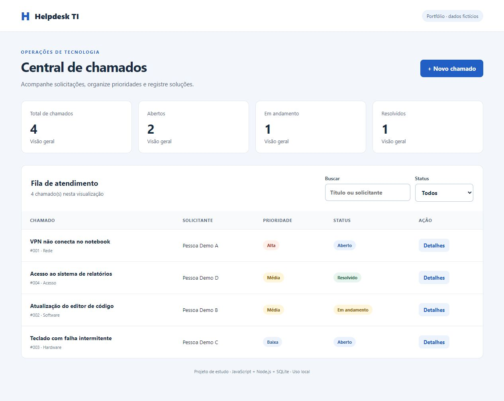

# Helpdesk TI

Sistema local de chamados de suporte técnico, com interface responsiva, API HTTP e persistência em SQLite. Projeto pessoal de portfólio de Erick Augusto, acompanhado de um roteiro de estudo e personalização.



## Problema e solução

Solicitações espalhadas em mensagens dificultam acompanhar o atendimento. Este projeto reúne os chamados em uma fila com prioridade, categoria e status. O escopo é uma demonstração local de uma central de suporte, com dados inteiramente fictícios.

## Funcionalidades implementadas

- Criar, consultar, editar e excluir chamados.
- Pesquisar por título ou solicitante e filtrar por status.
- Ordenar automaticamente por prioridade e, dentro dela, pelos mais recentes.
- Acompanhar total, abertos, em andamento e resolvidos. Os indicadores representam toda a base; os filtros afetam a fila.
- Persistir os dados ao reiniciar o servidor.
- Validar campos na interface e no servidor, tratar estados vazios e erros.
- Iniciar com quatro exemplos fictícios, sem recriá-los depois de excluídos.

Apresentação curta de produto e interface: acesse `/projeto` com o servidor em execução.

## Executar

Requisito: **Node.js 22.13 ou superior**. Testado localmente com Node 22.15. Não há dependências de terceiros para instalar.

```bash
git clone https://github.com/AugstConsagrado/helpdesk-ti.git
cd helpdesk-ti
npm start
```

Abra **http://127.0.0.1:3000**. Para encerrar, use Ctrl+C no terminal.

O módulo SQLite pode exibir um aviso de recurso experimental no Node 22; o aviso não impede a execução. O banco é criado em `data/helpdesk.db` e está fora do versionamento. Para usar outra porta, configure a variável `PORT` antes de iniciar.

## Testes

```bash
npm test
```

Os testes cobrem o ciclo completo dos chamados, validação, busca com conteúdo semelhante a SQL, persistência em arquivo, carga de exemplos e respostas HTTP de sucesso e erro. Usam bancos isolados da demonstração. O workflow em `.github/workflows/tests.yml` executa a suíte em cada push e pull request.

## Tecnologias e estrutura

- HTML e CSS: interface, formulário acessível e adaptação para celular.
- JavaScript no navegador: comunicação com a API e atualização da tela.
- Node.js: servidor HTTP sem framework.
- SQLite: armazenamento relacional com consultas parametrizadas.
- `node:test`: testes unitários e de integração.

```text
public/       interface web
src/store.js  validação e acesso ao banco
src/server.js rotas HTTP e arquivos estáticos
test/         testes
docs/         imagem e roteiro de estudo
data/         banco criado na primeira execução
```

Fluxo: formulário → `fetch` → API HTTP → validação → consulta parametrizada → SQLite → JSON → atualização da tela. Os textos inseridos pelo usuário são exibidos com `textContent`, sem interpretá-los como HTML.

## API

| Método | Rota | Uso |
|---|---|---|
| GET | `/api/tickets?q=&status=` | Listar e filtrar |
| GET | `/api/tickets/:id` | Consultar um chamado |
| POST | `/api/tickets` | Criar |
| PUT | `/api/tickets/:id` | Substituir os campos editáveis |
| DELETE | `/api/tickets/:id` | Excluir |
| GET | `/api/stats` | Indicadores gerais |

Exemplo de JSON para criação ou edição:

```json
{
  "title": "Falha na conexão de rede",
  "requester": "Pessoa de demonstração",
  "description": "O notebook não consegue acessar a rede local.",
  "category": "Rede",
  "priority": "alta",
  "status": "aberto"
}
```

Categorias: Hardware, Software, Rede, Acesso. Prioridades: baixa, media, alta. Status: aberto, em_andamento, resolvido. Respostas: 200/201 em sucesso, 400 para dados inválidos, 403 para origem não permitida, 404 para item ou rota inexistente, 413 para conteúdo muito grande e 415 para tipo de conteúdo incorreto.

## Decisões e limites

O SQLite simplifica a execução sem instalar um servidor de banco. O servidor foi mantido sem framework para tornar o fluxo HTTP visível no estudo. Não há login, anexos, permissões, histórico de alterações ou SLA. O servidor aceita apenas conexões locais e **não deve ser exposto como serviço de produção** nessa versão.

## Próximas melhorias propostas

- Histórico de alterações e comentários por chamado.
- Testes de interface automatizados no repositório.
- Paginação, responsável pelo atendimento e prazo de solução.
- Autenticação, autorização e proteção adequada antes de um eventual deploy.

Consulte [o roteiro de estudo](docs/ESTUDO.md) para entender, demonstrar e personalizar o projeto. Essas melhorias são propostas, não funcionalidades já implementadas.

Desenvolvimento com apoio de IA.
